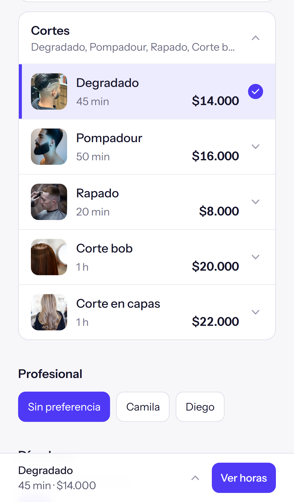
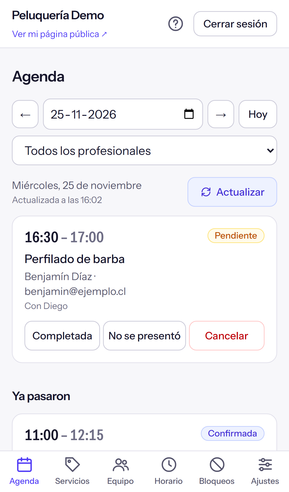
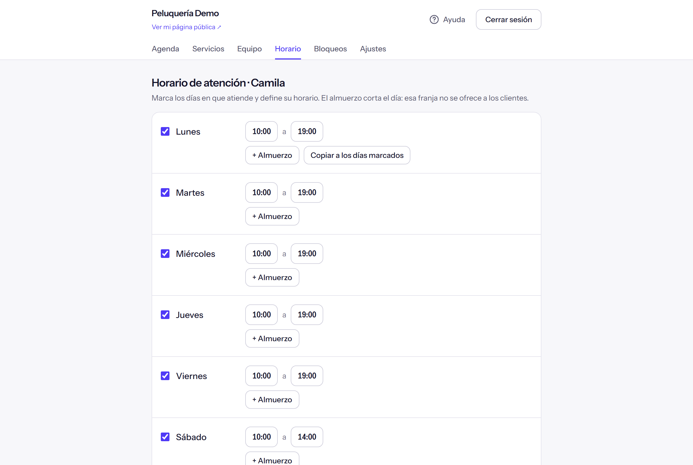
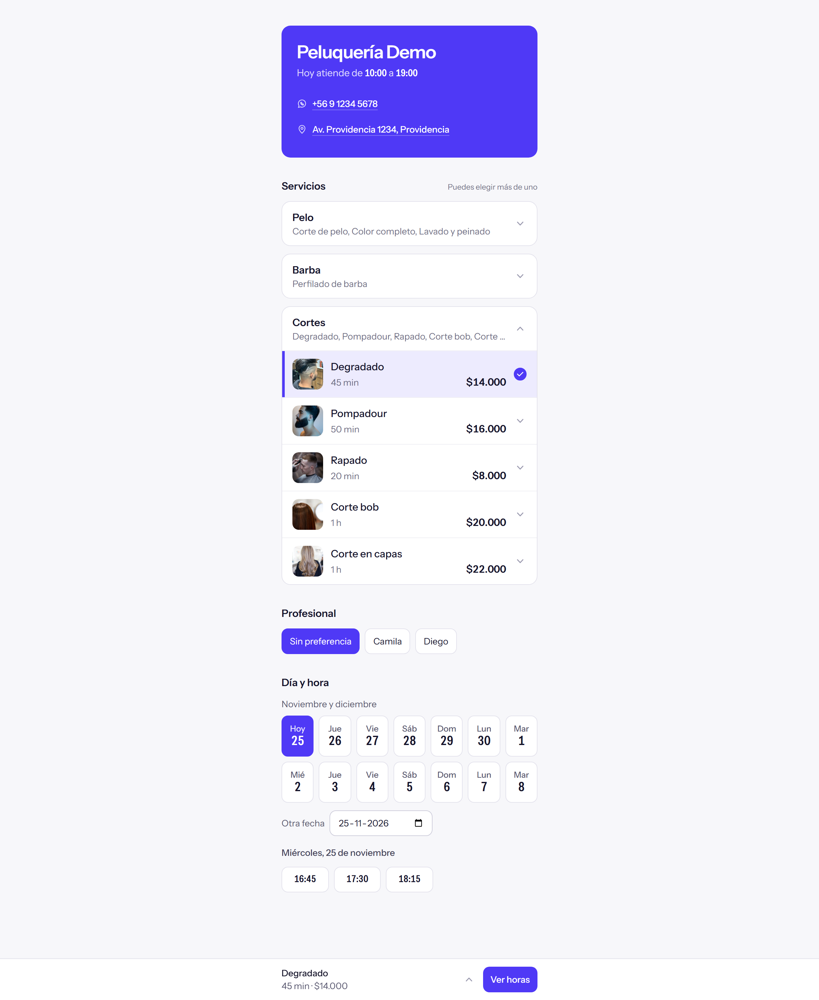

# Reservahoy


Plataforma de reservas online para pequeños negocios (talleres, peluquerías, consultas). Cada negocio tiene su página pública donde sus clientes reservan una hora **sin crear cuenta**, y un panel donde el dueño administra servicios, horarios y agenda.

**Demo:** https://reservahoy.cl/taller-demo
**Panel del negocio:** https://reservahoy.cl/login (para recorrerlo con datos de ejemplo, ver [Datos de prueba](#4-datos-de-prueba-opcional))

## Capturas

| El cliente reserva desde el celular | El negocio ve su agenda |
| :---: | :---: |
|  |  |

**Horario de atención de cada profesional**



<details>
<summary>Página pública completa en escritorio</summary>



</details>

## Funcionalidades

**Cliente (sin cuenta)**
- Elige uno o varios servicios (hasta 5, se hacen seguidos con un mismo profesional), profesional y día entre las horas realmente libres
- Servicios agrupados por categoría (ej. Hombres, Mujeres): se muestran solo las categorías y al tocar una se despliegan sus servicios, con la duración que corresponde a cada uno
- Al elegir un servicio ve su foto y su información adicional (qué incluye, qué traer, recomendaciones)
- "Sin preferencia": el sistema asigna al azar un profesional que tenga la hora libre
- Página con la marca del negocio: logo, color propio, "Hoy atiende de … a …", teléfono y dirección con enlace a Google Maps
- Reserva con nombre, correo y teléfono, y recibe una confirmación por correo
- Ve y cancela su reserva con un enlace privado, sin crear cuenta
- Recibe un correo cuando su servicio está listo, con fotos si el negocio las adjunta

**Negocio**
- Registro, inicio de sesión (cookie `httpOnly`, 30 días renovados con el uso) y restablecer la contraseña por correo
- Verificación del correo al registrarse: la página pública recibe reservas recién cuando el dueño confirma su correo
- Gestión de servicios: categoría, tiempo de atención, duración total estimada, precio opcional, información adicional (hasta 300 caracteres), foto, edición y activar/desactivar
- Equipo: profesionales con los servicios que realizan y su propio horario semanal, con almuerzo
- Agenda diaria con filtro por profesional, estados de la reserva (completada, no se presentó, cancelada) y actualización automática; si hoy no hay reservas, muestra la próxima
- Al cancelar una reserva desde la agenda confirma antes (con motivo opcional) y el cliente recibe un correo con el motivo y un enlace para reservar otra hora
- Al marcarla completada puede sumar hasta 4 fotos para el cliente; quedan guardadas en ese navegador hasta enviarlas
- Datos del negocio en Ajustes: nombre, teléfono, dirección, color de marca y logo
- Correo por cada reserva nueva (servicio, hora, profesional y datos del cliente, con enlace a ese día de la agenda); cada miembro elige todas, solo las suyas o ninguna
- Bloqueos de tiempo (vacaciones, feriados, trámites) por días completos o rangos de horas, para todo el negocio o un profesional; avisa si ya hay reservas en ese período
- Ayuda y sugerencias: cualquier miembro escribe al equipo de Reservahoy desde el panel
- Página pública propia (`/tu-negocio`) lista para compartir

**Equipo con cuenta propia**
- Roles: el dueño administra todo; el profesional ve y gestiona solo su agenda, su horario (en solo lectura) y sus bloqueos. El panel muestra solo lo de cada rol y el backend lo vuelve a negar
- Invitaciones por correo con un enlace de un solo uso (7 días); quien acepta crea su cuenta y entra al negocio
- Quitar acceso: desactivar a un miembro cierra sus sesiones al instante y anula su invitación pendiente

**Celular primero**
- En el celular el panel usa una barra de pestañas abajo, botones de 40 px y selectores de hora y color propios en vez de los del sistema
- Todas las páginas caben sin desplazamiento lateral desde 280 px (la pantalla exterior de un plegable), probado en Chromium y WebKit (Safari)
- Si en un teléfono real una página queda más ancha que la pantalla, llega un aviso a Sentry

**Calidad y seguridad**
- Sin dobles reservas, garantizado por una restricción de PostgreSQL y probado con peticiones concurrentes
- Aislamiento entre negocios y permisos por rol verificados en todas las rutas del panel con pruebas de punta a punta (sin sesión: 401; con la sesión de otro negocio: 404; lo que no es del rol: 403)
- Límites de peticiones por IP y de reservas por correo
- Errores reportados a Sentry sin datos personales
- Respaldos diarios cifrados
- Política de privacidad y términos según la Ley 21.719 de Chile

## Stack

| Capa            | Tecnología                                                                   |
| --------------- | ---------------------------------------------------------------------------- |
| Frontend        | Next.js (App Router), TypeScript, Tailwind CSS v4                            |
| Backend         | NestJS, TypeScript, Passport JWT, class-validator, luxon                     |
| Base de datos   | PostgreSQL 16 + Prisma                                                       |
| Infraestructura | Docker Compose (local), Vercel, Render, Neon, Cloudflare (DNS, R2), Resend   |
| Monitoreo       | Sentry, UptimeRobot                                                          |
| Testing         | Jest (unitarios e integración contra PostgreSQL), Playwright (Chromium y WebKit) |
| CI/CD           | GitHub Actions; despliegue automático al hacer merge a `main`                |

## Arquitectura

```
Navegador ──► Next.js (Vercel) ──► API NestJS (Render) ──► PostgreSQL (Neon)
                                         │
                                         ├──► Cloudflare R2 (fotos y logos)
                                         └──► Resend (correos)
```

## Decisiones técnicas

**Sin doble reserva, garantizado por la base de datos.** Validar en el código no basta cuando dos personas reservan a la vez. Una _exclusion constraint_ de PostgreSQL (`btree_gist` + rangos de tiempo) impide que un mismo profesional tenga dos reservas activas solapadas. Lo probé con peticiones concurrentes en el CI: una gana y las demás reciben un 409. Las reservas canceladas liberan la hora.

**Multi-tenancy deducido del token.** El `businessId` nunca viene del cliente: se obtiene de la membresía del usuario autenticado. Un negocio no puede ver ni modificar datos de otro, y los recursos ajenos responden 404 (no 403) para no revelar que existen. Verificado con pruebas entre dos cuentas.

**Cálculo de disponibilidad como función pura.** `computeSlots` no depende de Nest ni de la base de datos, por eso se prueba en aislamiento con Jest (horarios, solapes, horas pasadas, servicios que no caben antes del cierre y zona horaria).

**Zonas horarias.** Todo se guarda en UTC y se convierte con luxon según la zona del negocio (`America/Santiago`), evitando errores por el cambio de horario de verano.

**Seguridad.** Contraseñas con bcrypt, validación de DTOs con whitelist, rate limiting (más estricto en login y registro), slugs reservados, CORS restringido y respuestas públicas que no exponen datos de otros clientes.

**Sesión con cookie `httpOnly`.** El JWT viaja en una cookie `HttpOnly; Secure; SameSite=Lax`, inaccesible desde JavaScript, lo que mitiga el robo de token por XSS. Para que la cookie sea first-party, el frontend proxea `/api/*` hacia el backend con un rewrite de Next.js, evitando los problemas de cookies entre dominios.

**Jest en modo ESM.** NestJS 12 se publica solo como ESM, así que Jest corre con `ts-jest` en modo ESM (`--experimental-vm-modules` y `tsconfig.spec.json`). Así los servicios de Nest se prueban directamente contra PostgreSQL, sin mocks.

**Tests de integración contra PostgreSQL real.** La garantía anti-doble reserva se prueba en el CI con una base PostgreSQL 16 (servicio de GitHub Actions), incluyendo 10 peticiones simultáneas a la misma hora donde solo una prevalece.

**Tiempo de atención vs. duración total.** Cada servicio tiene `durationMin` (el tiempo que el profesional está ocupado, que bloquea la agenda y alimenta la restricción anti-solape) y `totalMin` opcional (duración total del trabajo, solo informativa). Así un taller puede recibir varios vehículos el mismo día aunque una reparación tarde un día completo, mientras que un corte de pelo bloquea la hora entera.

**Equipo con servicios y horarios propios.** Cada negocio puede tener varios profesionales, cada uno con los servicios que realiza y su propio horario semanal. Un profesional puede existir sin cuenta (lo administra el dueño) o entrar con la suya por invitación, y toda consulta se resuelve desde la membresía del usuario autenticado, así que un negocio nunca puede ver ni modificar profesionales de otro.

**Permisos por rol que parten cerrados.** El backend nunca pregunta "¿es profesional?", sino "¿es dueño?" (`isOwner`, `assertOwner`) y "¿qué profesional le toca ver?" (`scopeMemberId`). Así, un rol que se agregue en el futuro parte sin permisos en vez de heredar los del dueño por descuido. Lo que no es del rol responde 403 y un recurso de otro profesional, 404. Las reglas de cada rol están escritas como casos de prueba de integración y de punta a punta.

**Sesiones que se pueden cerrar.** El JWT lleva una versión de sesión guardada en la base: restablecer la contraseña o desactivar a un miembro la incrementa y cierra al instante todas sus sesiones abiertas, sin una lista negra de tokens. Desactivar es una transacción condicional: solo quien pasa al miembro de activo a inactivo cierra sus sesiones y anula su invitación.

**Celulares de todo tamaño.** Chrome en Android con la letra grande deja la página en apenas 280 px, y Safari en iPhone agranda la página al tocar un campo de menos de 16 px y no la vuelve a achicar. Una prueba de Playwright recorre todas las páginas y diálogos a 280, 320, 360 y 412 px (y de lado) en Chromium y WebKit, revisando que no haya desplazamiento lateral y que los campos midan 16 px. En producción, un componente avisa a Sentry si una página igual queda más ancha que la pantalla, con la ruta, el ancho y las clases del elemento que se sale, nunca el texto de la página.

**Reglas compartidas sin divergir.** Algunas reglas viven en el backend y en el panel (horario y almuerzo válidos, qué reservas se pueden completar, el enlace a Google Maps, la limpieza de datos para Sentry). Una prueba importa la copia del frontend y la compara caso por caso con la del backend, así que si una cambia sin la otra, el CI falla.

**Fotos del cliente que no quedan en la nube.** Las fotos de "servicio listo" son cosas del cliente y el bucket de fotos es público, así que no se suben a R2: viajan como imágenes dentro del correo. Hasta enviarlas quedan como borrador solo en el navegador (IndexedDB), que se borra al enviar, a los 7 días o al cerrar sesión, por si el equipo es compartido.

**"Sin preferencia" asigna al azar entre quienes tienen la hora libre.** Si el cliente no elige profesional, el sistema mezcla a los candidatos que hacen el servicio y asigna al primero con esa hora disponible, lo que reparte la carga a la larga sin favorecer a quien se creó primero. La hora que se ofrece es la unión de las horas libres de todos.

**Varios servicios en una misma reserva.** Una reserva es un solo bloque de tiempo con un profesional que hace todos los servicios elegidos, uno tras otro; los servicios quedan en una tabla aparte (`BookingItem`) con su orden. Así la restricción anti-solape sigue protegiendo el bloque completo sin cambios. El bloque dura la suma de los servicios y las horas se ofrecen cada "servicio más corto" (Corte 30 min + Barba 20 min se ofrece cada 20 min), para no dejar huecos sin usar. Solo se ofrecen los profesionales que hacen todos los servicios elegidos. La migración pasó el servicio de cada reserva existente a la tabla nueva antes de borrar la columna antigua.

**Concurrencia con varios profesionales.** La restricción anti-solape es por profesional, así que dos clientes pueden tomar la misma hora con profesionales distintos, pero nunca con el mismo. Lo cubren tests de integración contra PostgreSQL real, incluyendo 6 clientes simultáneos sobre 2 profesionales (solo 2 ganan). Los solapes y los deadlocks que PostgreSQL resuelve abortando una transacción se traducen a un 409 claro, y ninguna reserva queda duplicada.

**Correo transaccional con dominio verificado.** Los correos salen de un subdominio dedicado (`mail.`) con DKIM y SPF verificados y DMARC en modo monitoreo, lo que mejora la entrega y aísla su reputación. El envío nunca bloquea la reserva, y un límite por correo (3 por hora) junto al rate limit por IP evita que el formulario se use para enviar correo a terceros.

**Verificación de correo antes de recibir reservas.** Al registrarse se envía un enlace de un solo uso (vale 24 horas; en la base solo se guarda su hash SHA-256). El panel funciona desde el primer momento, pero la página pública no acepta reservas hasta que el dueño confirma su correo: así una cuenta creada con un correo ajeno no puede usar la plataforma para enviar correos a terceros. El reenvío está limitado a 3 por hora y las cuentas anteriores a esta función quedaron verificadas en la migración.

**Fotos reducidas en el navegador y guardadas en R2.** Antes de subirla, el navegador lleva la foto a 1200 px y la convierte a WebP: una foto de celular de 3-5 MB queda en unos 150 KB, sube rápido incluso con datos móviles y no hace falta procesar imágenes en el servidor (Render gratis tiene poca memoria). El backend no confía en el nombre ni en el tipo que declara el navegador: identifica el formato por los primeros bytes del archivo y solo acepta JPG, PNG o WebP (un SVG podría llevar código). Las fotos van a un bucket público de Cloudflare R2, que no cobra por descargas; cada subida usa una ruta nueva, así que la caché puede guardarlas para siempre, y la foto reemplazada se borra del bucket.

**Respaldos cifrados y verificados.** Un workflow diario de GitHub Actions hace `pg_dump`, cifra el archivo con `age` y lo sube a un bucket privado de Cloudflare R2 con retención de 30 días. La restauración se probó de punta a punta en una base limpia.

## Operación

- **Infraestructura:** frontend en Vercel, API en Render, PostgreSQL en Neon, DNS en Cloudflare.
- **Backend siempre despierto:** Render gratis apaga el servicio tras 15 minutos sin tráfico. Un monitor de UptimeRobot visita `/health/live` cada 5 minutos (no consulta la base, así Neon puede dormir) y avisa por correo si el backend cae.
- **Dominio:** `reservahoy.cl` es el principal; `www.` y `app.` redirigen a él (308, conservando la ruta). `FRONTEND_URL` en Render debe ser `https://reservahoy.cl`, porque arma los enlaces de los correos.
- **Respaldos:** diarios (06:17 UTC), cifrados con `age`, en Cloudflare R2, retención de 30 días. La clave privada se guarda fuera del repositorio y de GitHub.
- **Restaurar un respaldo:**
  1. Descargar el archivo `.dump.age` desde R2.
  2. Descifrar: `age -d -i clave.txt -o respaldo.dump archivo.dump.age`
  3. Restaurar: `pg_restore --no-owner -d <base> respaldo.dump`
- **Correo:** Resend, dominio `mail.` con DKIM verificado.
- **Correo de contacto:** `contacto@reservahoy.cl` es una dirección de Cloudflare Email Routing que reenvía a la casilla del dueño (no guarda correos). Para recibir en otra dirección del dominio se agrega una regla en Cloudflare → Email → Email Routing; el catch-all queda apagado para no recibir spam a direcciones inventadas. Solo recibe: las respuestas salen desde la casilla de destino.
- **Fotos:** bucket público de Cloudflare R2 con dominio propio; variables `R2_*` en Render (ver `backend/.env.example`). Sin ellas la subida de fotos queda desactivada.
- **Errores:** Sentry (plan gratis) avisa por correo de los errores 500 del backend, los errores en el navegador y en el servidor de Next, y los correos que no salieron tras los reintentos. Variables `SENTRY_DSN` en Render y `NEXT_PUBLIC_SENTRY_DSN` en Vercel (solo Production; se incluye al compilar, así que cambiarla pide redeploy). Sin ellas no se envía nada. No recibe datos personales: se apaga lo que Sentry recolecta por defecto y se borran correos, teléfonos, ids y tokens de las rutas (`backend/src/monitoring/scrub.ts`). Cada error lleva el commit desplegado (release), que Render y Vercel dan solos: así se ve si un error empezó con un merge.
- **Despliegue:** automático al hacer merge a `main` (Render y Vercel).

## Correrlo en local

Requisitos: Node 22 y Docker Desktop.

```bash
git clone https://github.com/josemjmqs/Reservaya.git
cd Reservaya
```

### 1. Base de datos (PostgreSQL en Docker)

```bash
cp .env.example .env
docker compose up -d
```

Edita `.env` si quieres cambiar la contraseña (usa solo letras y números: los símbolos como `@`, `#` o `/` rompen la URL de conexión). La base queda en el puerto **5433**, para no chocar con un PostgreSQL instalado en tu equipo.

### 2. Backend (http://localhost:3000)

```bash
cd backend
cp .env.example .env
```

En `backend/.env`:

- `DATABASE_URL`: usa **la misma contraseña y el mismo puerto (5433)** que el `.env` de la raíz.
- `JWT_SECRET`: cualquier texto largo.

```bash
npm install
npx prisma migrate dev
npm run start:dev
```

Comprueba que funciona: http://localhost:3000/health debe responder `{"status":"ok","database":"up"}`.

### 3. Frontend (http://localhost:3001)

En otra terminal:

```bash
cd frontend
cp .env.example .env.local
npm install
npm run dev
```

Abre http://localhost:3001/register, crea una cuenta y ya puedes crear servicios y horarios. Tu página pública quedará en `http://localhost:3001/<tu-slug>`.

### 4. Datos de prueba (opcional)

Para no partir de cero, crea un negocio demo con equipo, servicios (entre ellos tipos de corte con foto), horarios y reservas alrededor de hoy (ayer, los próximos días y una cancelada). Las fotos de los cortes se ven si agregas `R2_PUBLIC_URL=http://localhost:3001` en `backend/.env`: están en `frontend/public/seed/cortes` (fotos libres de Unsplash).

```bash
cd backend
npx prisma db seed                # hoy queda sin reservas
SEED_TODAY=1 npx prisma db seed   # también agrega reservas para hoy (en PowerShell: $env:SEED_TODAY=1; npx prisma db seed)
```

Entra en http://localhost:3001/login con `demo@reservahoy.local` / `demo1234` (la dueña) o `diego@reservahoy.local` / `demo1234` (un profesional, para ver el panel de ese rol). La página pública queda en http://localhost:3001/demo-peluqueria. Puedes correrlo las veces que quieras: borra y vuelve a crear solo el negocio demo, y se niega a correr si `DATABASE_URL` no apunta a una base local.

### Tests

```bash
cd backend
npm test                  # unitarios
npm run test:integration  # contra PostgreSQL (usa DATABASE_URL)
```

**Pruebas de punta a punta (Playwright)**, en `frontend/e2e/`: levantan la app completa con los datos de prueba y revisan, entre otras cosas:
- que ningún negocio pueda ver ni cambiar datos de otro en ninguna ruta de la API, y lo que puede y no puede hacer un profesional (la prueba falla si se agrega una ruta sin clasificar);
- reservar desde la página pública, cancelar con el enlace y que el dueño lo vea en su agenda;
- el registro, confirmar el correo y restablecer la contraseña;
- invitar a un profesional, aceptar la invitación y quitarle el acceso;
- el panel de cada rol, en escritorio y en el celular;
- todas las páginas y diálogos a 280, 320, 360 y 412 px y de lado, en Chromium y WebKit;
- el logo y el color de marca, el aviso de servicio listo con sus fotos, y ayuda y sugerencias.

Con la base local, el seed corrido y backend (`:3000`) y frontend (`:3001`) levantados:

```bash
cd frontend
npx playwright install chromium webkit   # solo la primera vez
npm run e2e
```

Levanta el backend con `THROTTLE_LIMIT=1000`: en las pruebas todas las peticiones del navegador llegan con la misma IP y el límite normal (60 por minuto) se alcanza. El CI las corre en el job `e2e` en cada PR.

### Problemas comunes

| Síntoma                                 | Causa y solución                                                                                                                                                           |
| --------------------------------------- | -------------------------------------------------------------------------------------------------------------------------------------------------------------------------- |
| `P1000` (autenticación)                 | La contraseña de `backend/.env` no coincide con la de `.env`. Si cambiaste la del `.env` raíz después de crear la base: `docker compose down -v` y `docker compose up -d`. |
| `P1001` (no alcanza la base)            | Docker no está corriendo, o el puerto de `DATABASE_URL` no es 5433.                                                                                                        |
| `docker compose up` falla por el puerto | Otro programa usa el 5433: cambia `POSTGRES_PORT` en `.env` y el puerto en `DATABASE_URL`.                                                                                 |

## Estructura

```
backend/    API NestJS (auth, business, services, members, invitations, working-hours, time-blocks,
            availability, bookings, agenda, notifications, settings, storage, support, health, monitoring)
frontend/   Next.js (página pública, gestión de reserva, registro y cuenta, panel, invitaciones, privacidad y términos)
            y pruebas de punta a punta en frontend/e2e
docker-compose.yml
```

## Mejoras pendientes

**Producto**

- Recordatorios automáticos antes de la hora reservada.
- Permisos configurables: que el dueño elija qué puede hacer cada miembro invitado.
- Rol de recepción: alguien que ve toda la agenda sin atender clientes.
- Avisar al negocio cuando el cliente cancela con su enlace.
- Panel instalable (PWA).
- Borrar un negocio completo o un cliente desde la plataforma.
- Notificaciones por WhatsApp (Cloud API de Meta) como segundo canal, aprovechando el `NotificationsService`.
- Campos personalizados por negocio (por ejemplo, patente en un taller).
- Pago de abono al reservar.
- Política de anticipación mínima para cancelar.
- Reparto por carga en vez de azar.

**Técnicas**

- Leer la zona horaria del negocio en la agenda en vez de fijarla en el frontend.
- Cargar el `AppModule` completo en Jest: `@nestjs/throttler` sigue en CommonJS y Jest solo carga ESM desde CommonJS en Node 24.9+ (mientras tanto, las rutas se prueban de punta a punta con Playwright).
- Tabla de transiciones permitidas entre estados de una reserva.
- Migrar a Prisma 7 cuando el ecosistema esté estable.
- Modelar capacidad real (varios boxes o puestos simultáneos), independiente de los profesionales.

## Autor

José Díaz · [GitHub](https://github.com/josemjmqs) · [LinkedIn](https://www.linkedin.com/in/jos%C3%A9-ignacio-d%C3%ADaz-hormaz%C3%A1bal-9b515143b)
